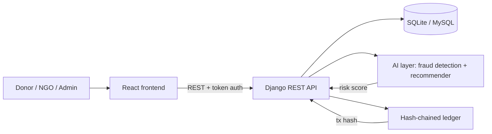

# TrustGive — AI-Based Donation Management System

An AI-Based Donation Management System using Deep Learning (DL) and ledger technology to manage donations efficiently and securely. It ensures transparent transactions, tracks donor contributions, monitors donation progress, and provides real-time insights, building trust and accountability between donors and organizations.

Connects donors, NGOs and beneficiaries on one platform (from the AIML project deck).

- **AI**: Isolation Forest fraud/anomaly detection (+ explainable rules) and a TF-IDF recommender (scikit-learn)
- **DLT**: hash-chained, tamper-evident ledger for donations, spending and reviews (`GET /api/ledger/verify/`)
- **Backend**: Python / Django REST Framework (SQLite by default, MySQL via `DB_ENGINE=mysql`)
- **Frontend**: React (Vite)

## Run
From the project root, install the JavaScript dependencies and start both services:

    npm install
    npm run dev

This runs the Django migrations and seed command, then starts:

- Frontend: http://localhost:5173
- Backend API: http://127.0.0.1:8000/api/

The frontend uses Vite's `/api` proxy, so no frontend API URL or separate CORS setup is
needed during local development. The backend uses the existing SQLite database at
`backend/db.sqlite3`. MySQL remains available only when `DB_ENGINE=mysql` and the
corresponding database environment variables are configured.

Demo logins (password `demo12345`): `donor1`..`donor8`, NGOs `hope`, `annapurna`, `medcare`, `reliefnow`; admin `admin` / `admin12345`.

## Flow (slide 14)
Donor logs in, picks a campaign, AI screens the donation (flagged ones wait for admin approval), record saved in DB, block appended to the ledger, donor gets a tx hash. The NGO records spending (also on the ledger, cannot exceed balance). A public transparency report shows totals.

## Tests
    python manage.py test        # 8 tests: flow, tamper detection, fraud flag, spending rules, recommendations

## Notes
- The ledger is a single-node permissioned chain; swap `donations/ledger.py` for Hyperledger/Ethereum calls to go multi-node.
- TensorFlow/Keras from the deck is optional: an autoencoder can replace the Isolation Forest in `donations/ai.py`.
- For production set `SECRET_KEY`, `DEBUG=0`, `NGO_AUTO_VERIFY=False` (admins then verify NGOs in `/admin/`).

## Architecture

